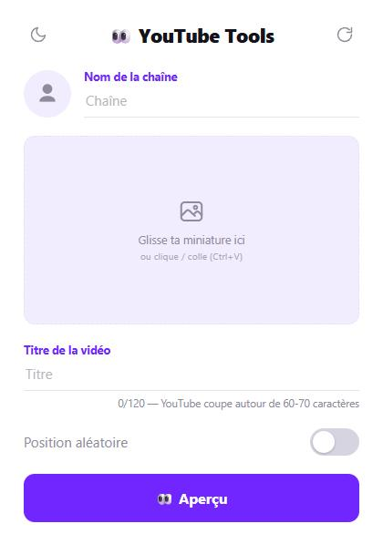
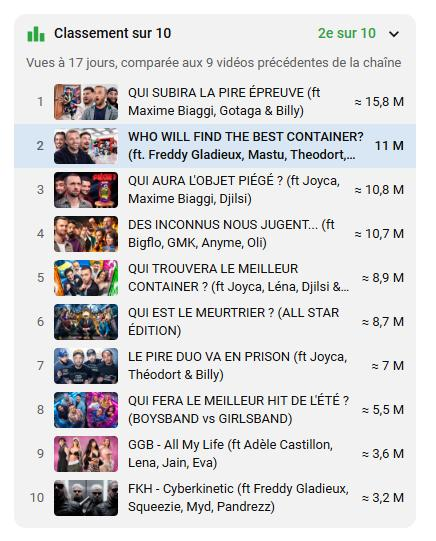
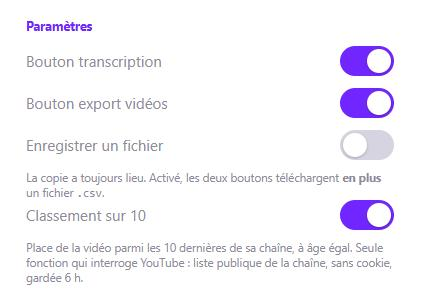

<div align="center">


# YouTube Tools

Teste ta miniature, copie une transcription, exporte un feed, situe une vidéo dans sa chaîne — **sans jamais quitter YouTube**.

[**⬇ Télécharger l'extension**](https://github.com/StundZow/youtube-tools/releases/latest/download/youtube-tools.zip) · [Releases](https://github.com/StundZow/youtube-tools/releases)

Chrome · Edge · Brave · Opera



</div>

> **Reprise de PrevYou.** Cette extension part de **PrevYou** de BenjaminCode (design BastiUi), **parce que la version publiée ne fonctionne plus** : Chrome a désactivé les extensions Manifest V2, et YouTube a renommé les classes CSS que l'ancien code ciblait. Tout a été recodé de zéro en MV3.

## Ce que ça fait

YouTube montre une foule de choses qu'il ne laisse pas récupérer : l'effet réel d'une miniature au milieu des autres, le texte d'une vidéo, les chiffres d'un feed, la place d'une vidéo dans l'historique de sa chaîne. Il faut tout relever à la main, ou renoncer.

YouTube Tools ajoute ses outils directement dans l'interface. Chacun sort une information que tu voyais déjà, dans une forme exploitable : du **CSV** prêt à coller dans un tableur ou un agent IA, et un aperçu de miniature posé **dans le vrai feed**, au milieu des vraies vidéos.

## Pourquoi pas juste ouvrir la miniature en grand ?

Parce que ce n'est jamais comme ça qu'elle sera vue. Ce qui compte, c'est la lisibilité du texte une fois réduit, le contraste face aux miniatures voisines, et la longueur du titre avant que YouTube ne le coupe. Aucun de ces trois points ne se voit hors du feed.

## Fonctionnalités

- 🖼️ **Aperçu de miniature dans le vrai feed** — accueil, abonnements, recherche, page de chaîne, suggestions du lecteur. Une vraie carte est clonée, donc le rendu suit toujours le layout courant de YouTube
- 🎲 **Position aléatoire** — place ta carte quelque part dans la grille plutôt qu'en tête, là où la comparaison est honnête
- 📝 **Transcription en CSV** — un bouton à côté du J'aime, timecodes et métadonnées de la vidéo inclus
- ✨ **Résumé de la vidéo par Gemini** — côte à côte avec la vidéo, timecodes cliquables, point en cours surligné
- 💬 **Résumé des commentaires** — une centaine chargés automatiquement, ressenti, tendances, critiques et demandes
- 💾 **Export des vidéos d'une page** — depuis la barre du haut, sur toutes les pages YouTube
- 🏆 **Classement sur 10** — où se situe la vidéo parmi les 10 dernières de sa chaîne, à âge égal
- 🌗 **Thème clair / sombre** — les boutons mesurent le fond de la page et s'y accordent, sans recharger
- ⚙️ **Paramètres** — chaque outil s'active ou se coupe depuis le popup
- 🔒 **Aperçu ponctuel** — rien ne s'affiche tant que tu n'as pas cliqué, et tout disparaît dès que tu navigues

## Prise en main

1. [**Télécharge `youtube-tools.zip`**](https://github.com/StundZow/youtube-tools/releases/latest/download/youtube-tools.zip) et décompresse-le.
2. Ouvre `chrome://extensions` et active le **Mode développeur** en haut à droite.
3. **Charger l'extension non empaquetée** → sélectionne le dossier `youtube-tools` obtenu.
4. Épingle l'extension dans la barre d'outils.

Ensuite, plus besoin de retélécharger : quand une nouvelle version sort, une pastille **MAJ** apparaît sur l'icône et le popup propose **Mettre à jour**. La première fois, Chrome te demande de désigner ce même dossier `youtube-tools` ; les fois suivantes, c'est automatique.

*(Sur Edge, Brave ou Opera : `edge://extensions`, `brave://extensions`, etc. — la marche à suivre est identique.)*

Pour l'aperçu de miniature : clique sur l'icône, renseigne la chaîne, glisse ou colle ta miniature, saisis le titre, puis **Aperçu**. L'onglet YouTube passe au premier plan avec ta carte injectée. **Retirer l'aperçu** l'enlève ; la flèche circulaire remet les champs à zéro.

## Les outils

### Aperçu de miniature

Volontairement **éphémère** : la carte n'apparaît qu'au clic, uniquement sur la page où tu as cliqué, et disparaît dès que tu navigues ou recharges. Tant que tu ne cliques pas, l'extension ne touche à rien.

### Transcription (bouton ☰, à côté du J'aime)

Copie toute la transcription dans le presse-papiers, métadonnées de la vidéo comprises :

```csv
titre,chaine,debut,fin,debut_s,texte,date,date_iso,vues,vues_num,likes,duree,duree_s,url,id
"Ma vidéo","Ma Chaîne","0:00","0:05","0","Première phrase","il y a 3 semaines","2026-08-16","1 659 225 vues","1659225","21816","1:00:44","3644","https://…","lZGoJT4abos"
```

`date_iso` est **toujours** une date absolue : une date relative pourrit, « il y a 9 mois » désignera autre chose dans trois mois. `vues_num` et `likes` reprennent les comptes exacts quand la page les donne. `duree_s` permet de trier et de calculer des densités.

### Résumé par Gemini (bouton ✨ Résumer, à côté du ☰)

Une fois la transcription copiée, un bouton **Résumer** apparaît à côté. Il envoie la transcription à **Gemini**, puis affiche le résumé **en haut de la colonne de droite**, à lire en même temps que la vidéo :

- **En bref** en une phrase, puis un **Déroulé** : une ligne courte et horodatée par moment, environ une toutes les 90 s, pour voir d'un coup d'œil de quoi parle chaque passage ;
- **À retenir** : deux ou trois idées clés, chacune avec le moment où elle est dite ;
- chaque **timecode est cliquable** et amène la vidéo au bon moment ;
- le point en cours de lecture est **surligné** au fil de la vidéo ;
- le temps de la lecture, le **classement sur 10 et le panneau de vidIQ s'effacent** pour que le résumé soit côte à côte avec la vidéo — sur cette vidéo seulement : les suivantes les retrouvent, et fermer le résumé les rend aussi.

Si Gemini oublie un timecode, l'extension retrouve le passage correspondant dans la transcription, sans nouvelle requête. Un timecode ainsi déduit s'affiche **encadré** plutôt que plein, pour qu'on sache que c'est une estimation.

Aucune clé d'API : c'est ta session Gemini qui répond. Une petite fenêtre Gemini s'ouvre le temps de la rédaction puis se referme toute seule — elle doit rester au premier plan, Gemini ne rédige pas dans un onglet caché. Il faut être connecté à [gemini.google.com](https://gemini.google.com) dans ce navigateur, et chaque résumé crée une conversation dans ton historique Gemini. Rouvrir le résumé d'une vidéo ne redemande rien.

### Résumé des commentaires (bouton dans l'en-tête des commentaires)

À côté de **Trier par**, un bouton **Résumer les commentaires**. YouTube n'en affiche qu'une vingtaine à la fois : l'extension fait défiler la page pour en charger une **centaine**, revient exactement où tu étais, puis les envoie à Gemini en **une seule demande**. Le résumé s'affiche juste sous l'en-tête :

- **En bref** — le ressenti général, en une phrase ;
- **La majorité** et **Une minorité** — ce que pensent la plupart des gens, et les avis moins répandus ;
- **Ce que les gens demandent** — une suite, un sujet, une précision.

Des points globaux et courts, pas de citations : ça se lit en dix secondes.

Les likes et le nombre de réponses accompagnent chaque commentaire : un avis très aimé pèse plus qu'un autre. Les timecodes cités par le public deviennent cliquables.

### Export des vidéos d'une page (bouton ⤓, barre du haut)

Copie toutes les vidéos **actuellement chargées** — rien n'est préchargé, donc déroule autant que tu veux avant de cliquer :

```csv
position,titre,chaine,vues,vues_num,date,duree,duree_s,multiplicateur,type,url
"1","KEYBOARD ESCAPE…","Kevko Gaming","149 k vues","149000","il y a 16 heures","18:48","1128","1.4x","video","https://…"
```

`position` donne le rang sur la page. `multiplicateur` reprend le `1.4x` de **vidIQ** si l'extension est installée. `type` vaut `video`, `short` ou `playlist`.

### Classement sur 10 (panneau, colonne de droite)

Place de la vidéo parmi les 10 dernières de sa chaîne, **à âge égal** : les plus anciennes ayant eu plus de temps, on estime combien de vues chacune avait au même âge. Reprise de la fonction du même nom de **Better YouTube Studio** (SQUIDUU), avec le même modèle de calcul.

<div align="center">

</div>

C'est la **seule** fonction qui interroge YouTube — la liste des vidéos d'une chaîne n'est pas dans la page. Elle le fait **sans aucun cookie**, uniquement sur des données publiques, avec un cache de 6 h, et l'interrupteur du popup la coupe entièrement.

## Paramètres

| Réglage | Effet |
|---|---|
| **Bouton transcription** | affiche ou retire le **☰** à côté du J'aime |
| **Bouton export vidéos** | affiche ou retire le **⤓** en haut de page |
| **Enregistrer un fichier** | télécharge un `.csv` **en plus** de la copie, pour les deux boutons |
| **Classement sur 10** | affiche le panneau — et coupe les seules requêtes de l'extension |

Les changements s'appliquent **immédiatement**, sans recharger l'onglet.

<div align="center">

</div>

## Vie privée

Les images sont redimensionnées puis gardées dans `chrome.storage.local`, sur ta machine. L'extension n'a **aucun serveur** à elle. Deux fonctions sortent du navigateur, et seulement quand tu les utilises :

- les **résumés** envoient la transcription ou les commentaires à **Gemini**, dans ta propre session Google ;
- le **classement sur 10** lit la liste publique des vidéos de la chaîne, sans cookie.

La **mise à jour automatique** lit `version.json` sur GitHub, sans cookie. Elle ne contacte jamais YouTube.

## Mise à jour automatique

Au démarrage du navigateur et à chaque ouverture du popup, l'extension lit [`version.json`](version.json) sur GitHub. Si une version plus récente existe :

1. une pastille **MAJ** s'affiche sur l'icône, et un bandeau **Version x disponible** en haut du popup ;
2. **Mettre à jour** ouvre une page dédiée, qui montre les nouveautés ;
3. **Mettre à jour maintenant** télécharge tous les fichiers, les écrit dans le dossier de l'extension, puis la recharge. Rafraîchis ensuite tes onglets YouTube (F5).

Aucune API ne permet à une extension de réécrire ses propres fichiers : on passe par l'accès aux fichiers du navigateur. La **première fois**, tu désignes le dossier `youtube-tools` (celui qui contient `manifest.json`) et tu autorises la modification. L'autorisation est mémorisée.

Garde-fous : tout est téléchargé **avant** d'écrire quoi que ce soit (une coupure réseau ne laisse pas l'extension à moitié à jour), le dossier choisi doit bien être celui de YouTube Tools, et la seule adresse contactée est `raw.githubusercontent.com`, sans cookie. Ça ne concerne que l'installation « non empaquetée » décrite plus haut. Mécanisme repris de [youtube-ad-tool](https://github.com/Slipers/youtube-ad-tool).

## Lancer les tests

```bash
node youtube-tools/tests/rank-core.test.js
```

Le cœur du classement, contre de vraies chaînes publiques. Environ 11 requêtes, sans cookie.

## Publier une nouvelle version (pour les mainteneurs)

```bash
node release.js "Ce qui change"
```

Le script lit le numéro de version dans `youtube-tools/manifest.json` — seule source de vérité —, écrit et pousse `version.json` (la version, le commit publié et la liste de ses fichiers, que lit la mise à jour automatique), fabrique l'archive, crée le tag et publie la release. L'archive porte toujours le même nom, donc le lien de téléchargement du README ne change jamais. Nécessite [GitHub CLI](https://cli.github.com/) authentifié, et un dépôt propre et poussé.

## Sous le capot

Comment l'extension survit aux refontes de YouTube, pourquoi elle lit les métadonnées par ce qu'elles *disent* plutôt que par leur nom de classe, comment elle cohabite avec vidIQ et Better YouTube Studio : voir **[NOTES-TECHNIQUES.md](NOTES-TECHNIQUES.md)**.

## Structure

```
youtube-tools/
├── manifest.json    MV3 — storage, scripting, activeTab, clipboardWrite
├── popup.html/css/js   interface (thème, drag & drop, paramètres)
├── common.js        réglages, remise CSV, maintien des boutons, thème
├── content.js/css   aperçu de miniature dans le feed
├── transcript.js/css   bouton ☰ et export de la transcription
├── summary.js/css   résumé de la vidéo, et interface commune des résumés
├── comments.js     résumé des commentaires
├── background.js    service worker : ouvre Gemini, rapporte sa réponse ; pastille MAJ
├── update-core.js   mise à jour : lit version.json, télécharge, écrit le dossier
├── update.html/css/js  page de mise à jour
├── gemini-writer.js pilote de la page Gemini (écrit, envoie, lit la réponse)
├── videos.js/css    bouton ⤓ et export des vidéos de la page
├── rank-core.js     calcul du classement (sans DOM, testable sous Node)
├── rank-bridge.js   lecture des données de la vidéo (monde de la page)
├── rank.js/css      panneau de la colonne de droite
├── tests/           tests du cœur de calcul
└── icons/           16 / 32 / 48 / 128 px
```

## Crédits

Concept et design d'origine : **PrevYou** par BenjaminCode, design par BastiUi. Le classement sur 10 reprend le modèle de **Better YouTube Studio** par SQUIDUU. Le pilotage de Gemini vient de **Google More**. Cette version est un recodage complet en Manifest V3.
